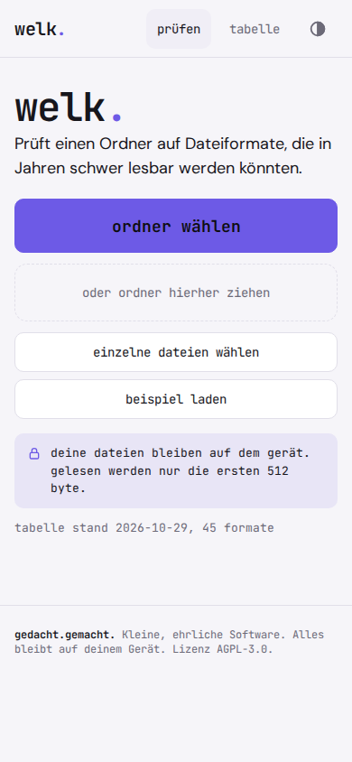
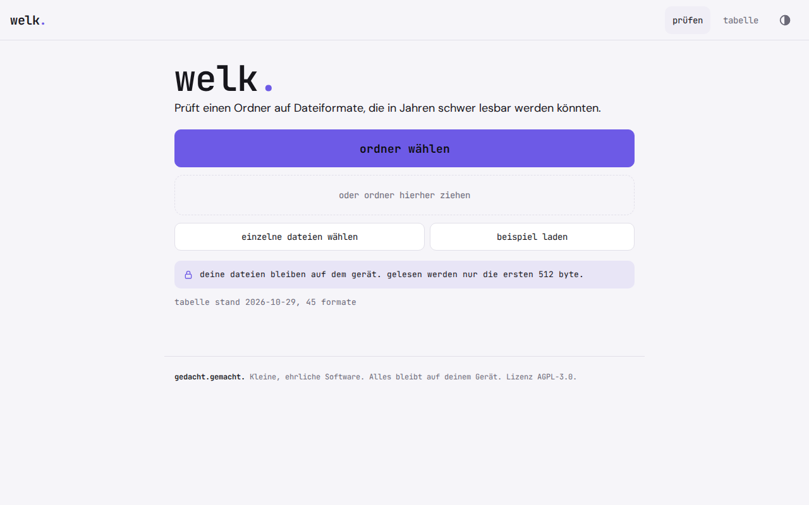

# welk.

**Which of your files will still open in ten years?** welk. checks a folder for file formats at risk of becoming unreadable and shows you where converting ahead of time is worth it. It is a digital preservation check for private people, clubs and small offices, running offline in the browser as a PWA, with no upload.

   

The app interface is in German.

Photos, letters, spreadsheets and videos often sit on a hard drive for years. Some formats survive that well (JPEG, PNG, PDF, plain text), others depend on one vendor or on programs that no longer exist (RealMedia, WordPerfect, Works, Flash, binary Office formats). You only notice when a file no longer opens. welk. reads the folder in the browser, identifies the formats and tells you per format: traffic light, risk range, reason and what to migrate to.

Pure computation, no AI, no server. Everything stays on your device.

<p align="center">
  
  
</p>

## Why

Whether a format will stay readable can be judged in advance: Is the specification open? Is there a standard? Is the format widespread? Do several independent free programs read it? Archives have answered these questions for years, but for specialists. Tools like DROID or Siegfried identify formats very precisely, but do not rate the risk. welk. is the simple version for private people, small clubs and offices.

How serious format obsolescence really is remains disputed among experts. That is why welk. gives no forecast with decimal places, but a range and a traffic light.

## Features

- **Choose a folder** or drop it in. Where the browser has no folder picker (some mobile browsers), you can select individual files
- **Format identification** for 45 everyday formats (image, document, audio, video, archive) via signatures and file extension, with a note on mismatch (for example `.jpg`, but PNG content)
- **Risk range** from 0 to 10 per format, plus a traffic light (green, yellow, red), a short reason and a migration target
- **Overview** with files and bytes per traffic light, the share of at-risk files as a range, and the formats sorted by risk, red first
- **Risk table** with all formats, criteria, sources and date, viewable in the app
- **Export** the report as JSON (`welk-bericht/1`) or as CSV for German Excel
- **Example folder** with made-up files, marked as **Beispiel** ("example") and removable with one click
- Light and dark, works offline, installable as an app

welk. converts nothing, validates nothing (whether a PDF really is PDF/A) and does not look inside archives such as ZIP. It only recommends.

## Privacy

Nothing leaves your device. welk. has no server, no account, no analytics, no ads and loads nothing from the network. Only the first 512 bytes of each file are read, the rest stays untouched. Results exist only while the page is open and are not stored in the browser. Reports only exist when you export them yourself.

## Install

welk. is a static web app. There is no build step and there are no dependencies.

1. Put the folder on any static host (your own web space, GitHub Pages, Netlify, a Raspberry Pi). Installing as an app needs HTTPS.
2. Open the address in the browser.
3. In the browser menu choose **Add to Home Screen** or **Install**. After that welk. starts like an app and also works without a network.

Test locally:

```
python3 -m http.server 8000
```

Then open `http://localhost:8000` in the browser. `index.html` also runs straight from a double click, only installing as an app needs a server.

## How it works

The full specification is in [`SPEC.md`](SPEC.md). It is enough to rebuild welk. in another language. The reference implementation is `welk.js` (runs in browser and Node, no dependencies), the data is in `tabelle.js`, the test vectors in `testvektoren.json`.

**In short:**

1. **Identify.** The format is determined from the first 512 bytes and the extension. Specific signatures come before general ones. Ambiguous signatures (OLE2, ZIP, TIFF) are only decided by the extension.
2. **Rate.** Each format has four criteria as a range from 0 (good) to 2 (bad): `offen` (open), `norm` (standard), `verbreitung` (adoption), `vielfalt` (independent implementations). Risk = 10 × sum ÷ 8, rounded, separately for the lower and upper bound. Unknown formats are fixed at `[2, 10]`.
3. **Traffic light.** Green if the upper bound is at most 3. Red if the lower bound is at least 6. Otherwise yellow.
4. **Total.** A file counts as at risk from risk 6. The share of at-risk files is a range: from "certainly at risk" (lower bound at least 6) to "at most at risk" (upper bound at least 6).

Example: a `.doc` file has the sums 4 (lower) and 6 (upper), so risk `[5, 8]` and therefore yellow. `film.rm` (RealMedia) comes out at `[9, 10]`, so red. A folder of `urlaub.jpg`, `brief.doc`, `film.rm` and one unknown file has 25 % to 75 % at-risk files.

**Tested:** the calculation functions are pure functions and checked with `node test-calc.js` against hand calculations and the test vectors from `testvektoren.json`. The test vectors are generated by `werkzeuge/testvektoren-erzeugen.js` from explicitly written-out bytes, not from the table.

**Known and assumed:**

- Format identification is known and verifiable, but coarser than DROID or Siegfried. Subformats (PDF and PDF/A, RAW variants, codecs inside containers) are not distinguished.
- The rating of the criteria is a curated judgment with sources, not a measurement. Experts would set some values differently. The PUIDs are assigned to the best of my knowledge and should be checked against PRONOM for archival use.
- It remains an assumption whether everyday formats will really become unreadable in ten to twenty years. welk. rates probabilities, not certainties.
- Equal weighting of the four criteria and the thresholds 3 and 6 are chosen, not derived.
- Green does not mean "readable forever", only low format risk. Very wide ranges (for example HEIC and camera RAW) show that the situation is disputed.

## License

GNU Affero General Public License v3.0 (AGPL-3.0), see `LICENSE`.

**Deutsch:** welk. prüft einen Ordner offline im Browser auf Dateiformate, die bald schwer lesbar werden könnten, und zeigt pro Format Risiko, Ampel und Migrationsziel für die Langzeitarchivierung, ohne Upload.

---

**gedacht.gemacht.** Small, honest software. Everything stays on your device. · [More projects](https://github.com/gedachtgemacht)
